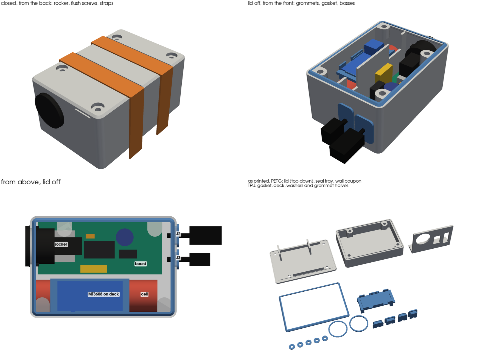

# Pod housing

Sealed box for the controller pod. It holds the pod PCB, the 18650 on its PH2.0
pigtail, the MT3608 module (U1), the KCD1 rocker (SW1), and the leads to both arm plugs,
J2 (SM-3) and J3 (SM-4). The box is PETG, so it carries the load and the boards don't.
The seals are printed TPU parts. The case is there to protect the board, so the
XIAO's USB-C has no opening. Flash it with the lid off.

## v5 — current

v4's layout in PETG, with TPU seals and a screwed lid. J2 and J3 leave on their leads
through split grommets.

**Outside:** 82.8 × 57.6 × 41.6, with 1.2 chamfers on the bottom and lid edges. The
outside is smooth apart from these:

- the rocker's bezel on the back end
- the J2 and J3 grommets in the front end
- four screw heads, flush in the lid
- two strap channels across the lid
- a fingernail notch under the lid edge at the back end, on the cell side

### Ends and wearing

- **Back end (-X):** the end behind the XIAO. The rocker points out of it
- **Front end (+X):** past the board's J2/J3 pads. J2 and J3 leave side by side here,
  each on its lead through a grommet
- **Straps:** two 12 mm Velcro straps go over the top, in 13.5 × 1.0 channels across
  the lid. They sit between the screw heads, 28.8 apart

### Layout

- **Board:** on four standoffs, 3.5 above the floor, with an M2×6 self-tapping screw in
  each corner hole. Its back edge is 2.1 off the back wall, so the XIAO's USB-C socket
  clears the wall by 0.5
- **Rocker:** comes through the back wall at the XIAO's centre line
  - **Fit it with the snap clips at the sides.** Across the clips it's 23. With the
    clips top and bottom, the lower clip hits the XIAO's socket
  - Its 20 body lies over the XIAO, 1.0 clear of the socket
  - Its 30 depth (body 14.5, then terminals and spade lugs) ends near X 25, short of
    C2 at 27
  - The lug wires come off over U2, with room to turn, and run to SW1
- **Cell:** beside the board in its own compartment
  - It rides on three saddles, 1.0 off the floor
  - The lead comes out of the front end, where there's 8.5 to turn it back over the
    cell. The mated PH2.0 pair lies on the cell's front end, past the deck (15.8 of room)
  - The J1 lead crosses the divider through a notch near the J1 pads
- **MT3608:** on a TPU deck on top of the cell, components and leads up. The deck
  starts 9.3 in from the back wall, to clear the screw boss in that corner
  - A lip on the middle of each rail snaps over its 0.95 board
  - **Rail gaps:** the trimpot's brass screw stands 1.1 past the module's long edge.
    The rails have a 6 gap where it sits, on both rails at both ends, so the module
    goes in either way round. The trimpot can't be reached from outside
  - Two pads under the deck press the cell 0.2, right over two saddles
  - Two ribs on the lid press the deck down 0.2
  - U1's wires cross the divider through a notch near the U1 pads
- **J2, J3:** the plugs stay on their leads outside the box. Each lead goes through a
  split TPU grommet in the front wall (darknetdoll's sizes)
  - **J2 (SM-3):** a 10 × 15 opening, long side up, and a 2.5 bore
  - **J3 (SM-4):** an 8 × 20 opening, long side up, and a 3.0 bore
  - Each plug goes out through its opening first. The grommet's two halves then
    close round the lead, so nothing is re-soldered
  - A panel mount wasn't possible for J2. The pod's SM-3 is the male half, whose
    latch release is at its wire end. In the wall, that release would be inside the
    box, and JST only makes the barbed female half for panels

### Why it's 41.6 tall

The rocker's body is 20 across and has to clear the XIAO's socket, which tops out
12.1 above the floor. That puts the top of its Ø20.6 hole 33.4 above the floor. The
gasket groove and the ledge under it need 2.4 above that, so the wall top is at 35.8.
Add the 2.4 floor and the 3.4 lid. Lifting the module onto the cell makes use of the
height and keeps the length to 82.8.

### Seals and fixings

- **Lid screws:** four M3×8 stainless button heads into M3 × 4.6 × 5.0 brass heat-set
  inserts, the hardware already in PARTS.md
  - **Bosses:** Ø8.5, centred 5.0 in from the long walls, two on each. They hang from
    the wall top on 45° corbels, so they print without support and leave the floor
    clear
    - Board side: at X 15, past the rocker's body, and X 66, short of the plug leads
    - Cell side: near both corners
  - **Insert holes:** 4.0 × 7.0 deep. This is deeper than PARTS.md's 6.0 because the
    counterbore and washer put 6.3 of the screw below the lid
  - **Lid:** 3.4 thick. Each head sits flush in a Ø7.2 × 2.2 counterbore on a TPU washer
    (7.0 × 2.8 × 0.8). The screws are inside the gasket line, so the washers seal
    the screw holes
  - **Hard stops:** the lid seats PETG to PETG on the outer 1.05 of the wall top and
    on the boss tops. Tighten until it seats and no further. The stops take the load
    and the lip does the sealing
  - **Ribs:** 1.6 × 4.5 ribs under the lid run along both long walls between the bosses.
    They keep the lid flat on the lip between the screws
- **Lid gasket:** TPU, a base and a lip
  - The base is 1.3 wide and presses into a 1.2 × 1.0 groove in the wall top. The wall
    top has a 1.0 ledge inside, which carries the groove's inner side
  - The lip leans 45° inward and stands 1.2 proud. A 0.6 pocket in the lid's
    underside squashes it 0.6, and the squashed tip slides about 0.4 inward, inside
    the pocket
  - **Why a lip and not a cord:** 95A is too stiff to squeeze. A solid TPU cord would
    take more force than four M3s can give, and the lid would bow up between them. The
    lip bends instead, with little force and 0.6 of travel to spare
- **Rocker:** a Ø20.6 hole. The v4 coupon's 19.8 TPU hole stayed stretched round the
  body, and PETG won't stretch
  - The wall is thinned from inside to 1.2 across a 26 × 8 band at the sides, where
    the clips catch
  - A TPU washer (Ø23.4 × Ø20.6) goes under the bezel. It seals the gap, and its
    thickness makes up the panel for the clips. There are two, 0.6 and 1.0; use
    whichever lets the clips catch firmly
- **Grommets:** each neck is 0.15 a side bigger than its opening. That squeezes the
  two halves together and onto the lead
  - A 1.5 flange sits on the outside face
  - A 0.6 chamfered ridge snaps past the inside face
  - The halves split across the long side

### Measured

darknetdoll, calipers, 2026-10-29. Every value is a constant at the top of
`export_v5.py`.

| What | Measured | Drives |
|---|---|---|
| Pod board thickness | 1.65 | board stack |
| Pod board underside to the top of the XIAO's USB-C socket | 8.6 (socket top 6.95 above the board) | rocker height, so the box height |
| USB-C socket face to the board's far edge | 71.6 (socket stands 1.6 past the edge) | back wall position |
| C3, the 0.1 µF disc, above the board | 5.0 (C2 taken as the same) | clearance under the rocker's lugs |
| MT3608 board, L × W × thickness | 36.8 × 17.2 × 0.95 | deck pocket and lips |
| MT3608 overall height, flat underside to the trimpot screw | 7.9 | room under the lid |
| MT3608 width over the trimpot screw | 18.3 (screw stands 1.1 past the edge) | rail gaps |
| Trimpot screw, centre from the VOUT end, and Ø | 8.9, 2.3 | rail gap position |
| Rocker across the snap clips | 23 | clip band, clips at the sides |
| Rocker body, bezel seat to the terminals | 14.5 | rocker stand-in |
| Rocker depth with the spade lugs on | 30 (20 if soldered direct) | rocker stand-in |
| Spade lug boots: both side by side, one boot | 10, 6.7 | rocker stand-in |
| Cell | Ø18.5 × 69, lead on the end | cell bay |
| Grommets, 2026-10-30: opening and bore | J2 10 × 15, 2.5. J3 8 × 20, 3.0 | front wall openings, grommets |

Still not measured:

- **Rocker bezel Ø:** 23 is assumed. It sets the washer's outside
- **Rocker body Ø under the bezel, and the clips' panel range:** these set the
  Ø20.6 hole and the 1.2 panel. The wall coupon tests both
- **C1:** the board needs 28 inside if C1 is 22 tall, and the box has 35.8

The export's clash check puts stand-ins for all of these in the box and finds no
overlap. The exceptions are deliberate: the deck pads' and lid ribs' 0.2 squeezes,
the gasket's fit and lip squeeze, and the grommets' fit.

### Sources

- **Board:** outline, holes and part positions from [pod_pcb.py](../../docs/pcb/pod_pcb.py).
  Part heights from the [PCB README](../../docs/pcb/README.md): C1 17–22, Q1 ~20,
  F1 ~18
- **Inserts and screws:** [PARTS.md](../../PARTS.md), M3 heat-set inserts and screws
- **JST SM:** catalogue (`jst-mfg.com/product/pdf/eng/eSM.pdf`). Only the SMP plug
  housing (female contacts) has panel barbs. The SMR receptacle (male pins) carries
  the latch arm, with its release at the wire end
- **From darknetdoll, 2026-10-29:**
  - Rocker: out of the back over the board, behind the XIAO, no boot
  - Velcro: 12 wide, over the top
  - J2/J3: on one side, the front end
  - USB-C: no opening
  - Trimpot: must not be reachable from outside
- **From darknetdoll, 2026-10-30:**
  - PETG housing, TPU only for gaskets, and a screwed lid
  - The pod's J2 is the male SM-3 half
  - J2 and J3 leave through split grommets, at the sizes above

### Print

- **PETG:** bottom, lid, seal tray, wall coupon
  - Use 6 or more wall loops so the 2.4 walls print solid; thin FDM walls leak
    through the layer lines (BUILD step 11)
  - Use 0.2 layers
- **TPU 95A from the external spool:** gasket, seals, deck. Not "TPU for AMS": that's
  68D and too stiff to seal (see
  [wrist-splint-mount.md](../wrist-splint-mount/wrist-splint-mount.md))
- **Bridges:** print them slowly. In the bottom, they're the tops of the grommet
  openings (10 and 8) and of the rocker hole (~7). In the lid, they're the strap
  channel floors (13.5) and the counterbore floors, because the lid prints top face
  down

| File | Material | Orientation | Supports |
|---|---|---|---|
| `versions/pod-housing-v5-seal-tray.stl` | PETG | Floor down | None. **Print first**, with the lid, gasket and seals |
| `versions/pod-housing-v5-wall-coupon.stl` | PETG | On its foot | None. **Print first** |
| `versions/pod-housing-v5-lid.stl` | PETG | Top face down (as exported) | None |
| `versions/pod-housing-v5-gasket.stl` | TPU | Base down (as exported) | None |
| `versions/pod-housing-v5-seals.stl` | TPU | Flat (as exported) | None |
| `versions/pod-housing-v5-bottom.stl` | PETG | Floor down | None |
| `versions/pod-housing-v5-deck.stl` | TPU | Flat (as exported) | None |

The seals file holds:

- five screw washers (one spare)
- the two rocker washers, 0.6 and 1.0
- both grommets, as four halves lying on their split faces

What each coupon tests:

- **Seal tray:** the real wall top, groove and bosses on a tray 15 deep. Use it with
  the real lid, gasket, washers, inserts and screws. The lid is the real part, so
  keep it if it passes. Check:
  - that the lid seats on its stops without forcing it
  - that it seals: fill the tray 10 deep, screw the lid down, turn it over and leave
    it
  - that it seals in the middle of the long sides, where the lid would bow
- **Wall coupon:** the back wall round the rocker hole, and the front wall round both
  grommet openings, at their real heights and printed the same way as the bottom.
  Check:
  - the rocker with each washer, clips at the sides
  - each plug through its opening, then the grommet halves round its lead

### Assembly

1. Set the four inserts in the bosses with a soldering iron at 240 °C, flush to
   0.2 below the top
2. Press the gasket's base into the groove all round, lip leaning inward
3. Fit the board onto the standoffs, 4 × M2×6 self-tapping
4. Slip a rocker washer over the rocker's body, then push it in from outside the back
   wall, clips at the sides. Its body lies over the XIAO. Run the lug wires to SW1
5. Push each plug out through its opening: J2 through the 10 × 15, J3 through the
   8 × 20
   - Close the two grommet halves round the lead outside the box, flange outward
   - Push the grommet in until the ridge snaps past the inside face
   - Put a cable tie on the lead inside, against the grommet, so a tug on the plug
     doesn't reach the solder joints
   - Leave a drip loop outside
6. Lay the cell on the saddles, lead toward the front. Mate PH2.0 and lay the pair
   on the cell's front end
7. Set the deck on the cell behind the pair, rails up. Feed U1's wires over the
   divider notch, then press the MT3608 into its pocket, leads up, until the lips
   click over its board. The trimpot screw goes in a rail gap
8. Lid on, with a TPU washer under each screw head. Tighten the four screws in turn
   until the lid seats
9. Straps over the top, in the channels

### Decided

- **Seal, no drain** (darknetdoll, 2026-10-29). This overrides BUILD step 11's "drain
  it, don't seal it": no drain hole and no breather
  - Opening the pod to dry it after every event (BUILD step 11) matters more now
- **MT3608 in the cell compartment is fine** (darknetdoll, 2026-10-29). This overrides
  BUILD step 11's rule of nothing soldered in with the cell. The TPU deck keeps the
  module off the cell
- **PETG housing, TPU seals, screwed lid** (darknetdoll, 2026-10-30). An all-TPU box
  leaves the circuit boards to carry the load
- **J2 and J3 on leads through split grommets** (darknetdoll, 2026-10-30), at their
  sizes. No re-soldering

### Open

- **Lip squeeze:** untested. The seal tray tests it. If it weeps mid-side, the pocket
  can be made shallower, for more squeeze
- **Rocker:** the 20.6 hole, the 1.2 panel and the 23.4 washer rest on unmeasured
  sizes (see Measured). The wall coupon tests them
- **Grommet bores:** 2.5 and 3.0 are darknetdoll's sizes, for round leads. A flat
  ribbon lead would need a slot instead
- **Plugs outside:** unmated, an SM plug is open to the weather. Dielectric grease in
  the shells (BUILD) still applies
- **Arm fit:** the bottom is flat and 57.6 wide, so it will rock on a round upper arm

## v4 — archived, coupons printed

v5's layout, all in TPU 95A, with a snap lid and J2/J3 panel-mounted in a 1.8 front
wall:

- **Lid:** snapped on with no screws. It had a skirt 0.25 oversize inside the walls, a
  45° snap bead and a wall-top bead
- **Rocker:** a Ø19.8 hole, meant to grip the body, with the wall thinned to 2.0
  round the clips
- **J2, J3:** JST's panel cutout for the SMP plug housing, from the 1.5–2.0 column
- 82.8 × 57.6 × 42.4
- **Coupons, 2026-10-30:** see the print log. Then the housing moved to PETG, because
  an all-TPU box makes the boards structural
- **Files:** `versions/archive/pod-housing-v4-*.stl` (`export_v4.py`)

## v3 — archived, never printed

v4's layout, with estimated part sizes in place of measured ones:

- The MT3608 was assumed to be 36 × 17 × 14 tall, against the measured 36.8 × 17.2 ×
  7.9, so its deck pocket was too short. Its rails had no gaps for the trimpot screw
- The rocker's clips were assumed to stay inside Ø21, against the measured 23
- The XIAO's socket was assumed to stand 1.5 proud, against the measured 1.6
- 82.7 × 57.6 × 42.3
- **Files:** `versions/archive/pod-housing-v3-*.stl` (`export_v3.py`)

## v2 — archived, never printed

Snap lid and module deck as v4. Differences from v4:

- The rocker hung from the lid
- The MT3608 deck sat over the XIAO
- J2 and J3 were on either side of the rocker in the front end
- The USB-C port came through a 5.4 back wall, with a plug
- Four Velcro loops at the base
- 104.0 × 57.3 × 36.4
- **Files:** `versions/archive/pod-housing-v2-*.stl` (`export_v2.py`)

## v1 — archived, never printed

Same board, cell compartment and plug cutouts as v4. Differences from v4:

- The rocker went through the cell-side wall
- The MT3608 had its own bay past the board
- The lid was screwed down with 4 × M3 into corner ears outside the walls
- The USB-C port had a collar standing 3 proud of the end wall
- 116.0 × 57.6 × 32.8, ears to 126 × 68
- **Files:** `versions/archive/pod-housing-v1-*.stl` (`export_v1.py`)

## Print log

| Date | Version | Result |
|---|---|---|
| 2026-10-30 | v4 wall coupon, TPU 95A | **Rocker:** went through the Ø19.8 hole, but the TPU stayed stretched round it, so a rigid wall needs a bigger hole. **SM-3 cutout:** fits the female half, but the pod's J2 is the male half |
| 2026-10-30 | v4 snap coupon, TPU 95A | The lid fits well |
