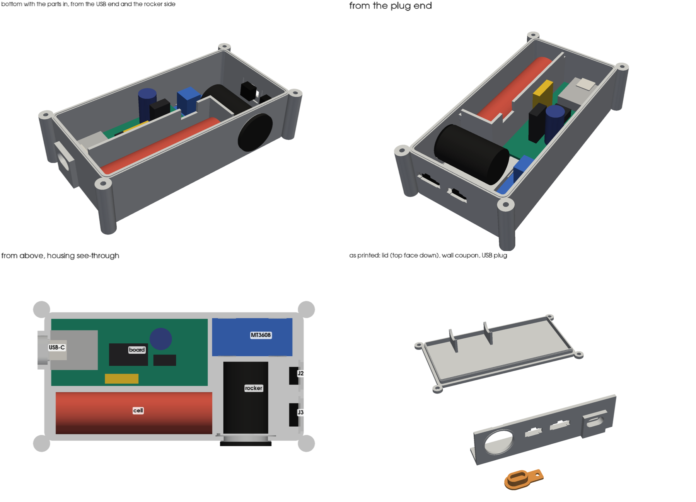

# Pod housing

Sealed TPU box for the controller pod. It holds the pod PCB, the 18650 on its PH2.0
pigtail, the MT3608 module (U1), the KCD1 rocker (SW1) and both arm plugs, J2 (SM-3)
and J3 (SM-4). There are two halves: a deep bottom that everything mounts in, and a
flat lid. The gaskets are TPU, printed as part of the halves.

## v1 — current

### Layout

- **Board:** on four standoffs, 3.5 above the floor, with an M2×6 self-tapping screw in
  each corner hole. The XIAO's USB-C comes through the end wall
- **Cell:** beside the board in its own compartment. A divider and a cross wall close
  it off, as [BUILD.md](../../BUILD.md) step 11 asks
  - It rides on three saddles, 1.0 off the floor
  - Two ribs on the lid press it down 0.2
  - The mated PH2.0 pair lies on top of the cell, between the ribs. The J1 lead
    crosses the divider through a notch near the J1 pads
- **Past the board's plug end:**
  - The MT3608 lies flat in a pocket, components up, held by four snap lips
  - The rocker goes through the side wall on the cell side
  - J2 and J3 snap into the end wall
- **Size:** 116.0 × 57.6 × 32.8 outside, plus the four corner ears (126 × 68 overall)

### Seals

- **Lid:** two seals
  - A skirt runs 4 deep inside the walls, 0.25 oversize all round, with a stepped
    lead-in
  - A 1.0 × 0.4 bead on the wall top is squashed by the lid
  - Four M3×16 self-tapping screws go into ears outside the seal, so no screw hole
    opens into the box
- **J2, J3:** JST's own panel cutout for the SMP plug housing. You push the housing
  from inside until the barbs click, and its flange pulls tight on the inside face. The
  wall is thinned to a 1.5 panel round each cutout (JST allows 0.5–2.0)
- **Rocker:** Ø19.8 hole, 0.2 under the 20 mm cutout so the TPU grips the body
  - There's a 0.4 bead ring under the bezel. The snap clips pull the bezel onto it
  - The wall is thinned to 2.0 round the hole
- **USB-C:** a collar stands 3 proud round the port
  - Its bore (13.0 × 7.4) fits the cable's overmold right up to the socket mouth
  - The printed plug pushes into the bore, 0.15 oversize. Its tab has a Ø2.5 hole
    for a tether

### Sources

- **Board:** outline, holes and part positions from [pod_pcb.py](../../docs/pcb/pod_pcb.py).
  Part heights from the [PCB README](../../docs/pcb/README.md): C1 17–22, Q1 ~20,
  F1 ~18. The lid clears 22 by 0.9
- **SMP cutout:** JST SM catalogue (`jst-mfg.com/product/pdf/eng/eSM.pdf`), panel
  layout, the 1.0–1.5 panel column
  - SM-3: A 8.2, B 12.3. SM-4: A 10.7, B 14.8
  - Heights 4.15 (B band) and 5.15 (A band), key 4.0 × 1.6
- **Pod leads:** both end in SMP plug housings, the half with the springy side barbs,
  read from the bench photo of 2026-10-29

### Not measured — check before printing the bottom

Every value is a constant at the top of `export_v1.py`. Change it there and re-run.

| What | Used | Drives |
|---|---|---|
| Cell diameter | 18.8 | cell bay width, saddles, lid ribs |
| Cell length, pigtail end included | 70 (bay is 74.7) | cell compartment |
| MT3608 module L × W × H | 36 × 17 × 14 (listing size) | pocket, box length |
| KCD1 depth behind the panel, spade lugs on | 33 | room behind the rocker |
| KCD1 panel range for the snap clips | 2.0 used | wall at the rocker |
| USB-C socket centre above the PCB top | 5.3 | USB opening height |
| Tallest part above the PCB (C1 as fitted) | 22 | box height |
| Cable overmold | ≤ 13.0 × 7.4 | collar bore |

The export's clash check puts stand-ins for all of these in the box and finds no
overlap, apart from the lid ribs' 0.2 squeeze on the cell.

### Print

- **Material:** TPU 95A from the external spool. Not "TPU for AMS": that's 68D and too
  stiff to seal (see [wrist-splint-mount.md](../wrist-splint-mount/wrist-splint-mount.md))
- **Walls:** set wall loops to 6 or more so the 2.4 walls print solid. Use 12
  top and bottom layers at 0.2
- **Bridges:** print the bridges slowly. The tops of the SMP cutouts (up to 14.8 wide)
  and of the rocker hole (~7) bridge. Trim any sag

| File | Orientation | Supports |
|---|---|---|
| `versions/pod-housing-v1-wall-coupon.stl` | On its foot | None. **Print this first** |
| `versions/pod-housing-v1-bottom.stl` | Floor on the bed | None |
| `versions/pod-housing-v1-lid.stl` | Top face down (as exported) | None |
| `versions/pod-housing-v1-usb-plug.stl` | Cap down (as exported) | None |

The wall coupon is the same wall as the bottom, printed the same way. It has the rocker
hole, both SMP cutouts and the USB collar at their real heights, so the snap fits and
seals can be tried before the full print. The USB opening's position against the
XIAO can only be checked in the real bottom.

### Assembly

1. Fit the board onto the standoffs, 4 × M2×6 self-tapping
2. Push J2 and J3 out through their cutouts from inside, key up, until they click
   - J2's lead is long: coil the spare over the module, or shorten it
   - J2 is the SM-3, the narrower cutout
3. Press the MT3608 into its pocket, components up, under the lips
4. Snap the rocker in from outside and feed its lugs through
5. Lay the cell on the saddles, pigtail toward the plug end, then mate PH2.0 over the cell
6. Press the lid on, skirt first, and fit 4 × M3×16 self-tapping into the ears
7. Push the USB plug into the collar

### Open

- **Drain:** BUILD step 11 says drain, don't seal: a 2 mm drain at the low corner and
  a breather. v1 has neither, because this housing aims to seal. Decide which rule wins
- **Mounting:** no strap loops yet. The bottom is flat and 57.6 wide, so it will
  rock on a round upper arm
- **Second arm:** the rocker faces the cell side. On the other arm it faces the
  other way unless the layout is mirrored
- **Cell swap:** changing the cell now means four screws. BUILD wants a cradle lid that
  opens without a tool

## Print log

| Date | Version | Result |
|---|---|---|
