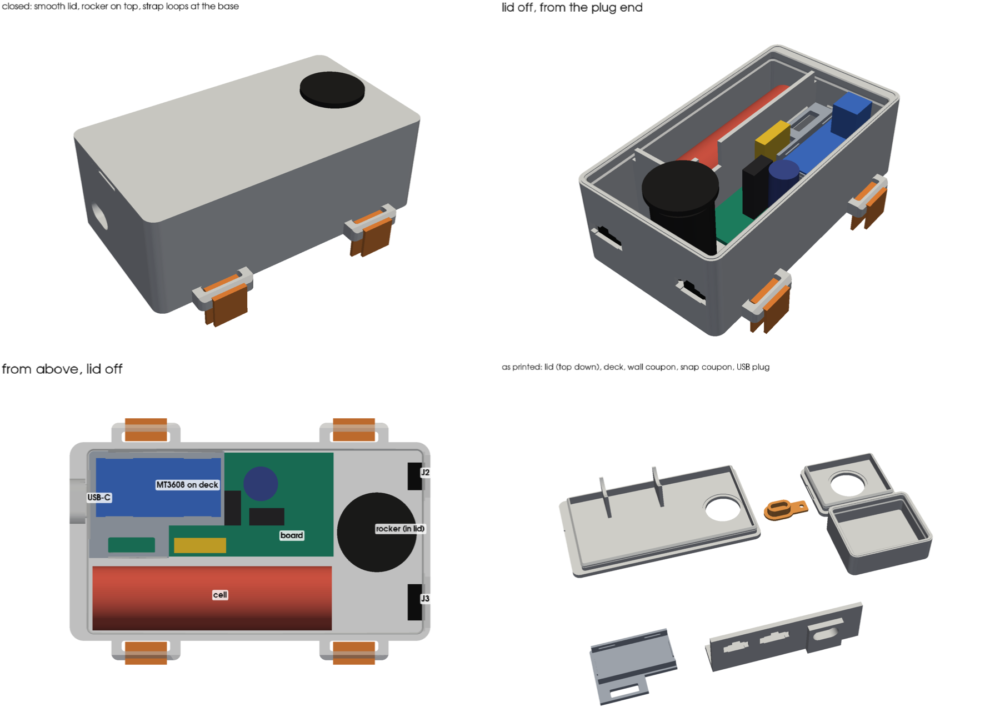

# Pod housing

Sealed TPU box for the controller pod. It holds the pod PCB, the 18650 on its PH2.0
pigtail, the MT3608 module (U1), the KCD1 rocker (SW1) and both arm plugs, J2 (SM-3)
and J3 (SM-4). There are two halves: a deep bottom that everything mounts in, and a
lid. The gaskets are TPU, printed as part of the halves.

## v2 — current

**Outside:** 104.0 × 57.3 × 36.4, plus the strap loops (68.5 wide at the base). The
outside is smooth: no screws or ears. Only these break the surface:

- the rocker's bezel on the lid
- the USB-C port and both plug cutouts in the end walls
- four strap loops at the base
- a fingernail notch under the lid edge at the USB end

### Layout

- **Board:** on four standoffs, 3.5 above the floor, with an M2×6 self-tapping screw in
  each corner hole. The XIAO's USB-C comes through the end wall
- **MT3608:** on a TPU deck over the XIAO and U2. It lies components up, held by
  four snap lips
  - The deck rests on ledges on the +Y wall, the -X wall and the divider, and
    snaps under a lip on each
  - A slot in the deck lets U1's four wires through to their pads
  - The deck goes in after the board is screwed down. It covers H1 and H3
- **Cell:** beside the board in its own compartment. A divider and a cross wall close
  it off, as [BUILD.md](../../BUILD.md) step 11 asks
  - It rides on three saddles, 1.0 off the floor
  - Two ribs on the lid press it down 0.2
  - The lead comes out of the end toward the plugs and turns back over the cell.
    The mated PH2.0 pair lies on top of the cell, between the ribs
  - The J1 lead crosses the divider through a notch near the J1 pads
- **Past the board:** the rocker hangs from the lid, centred between J2 and J3 in the
  end wall
- **Strap loops:** two at the base of each long side, 60 apart and centred on the
  box. A 12 mm Velcro strap comes up from round the arm, through the 14 × 3 slot, and
  back down over the bar

### Why it's 36.4 tall

The rocker sets the height, not the board. It is about 30 deep from the bezel seat
to the end of its spade lugs, and the lug wires come out downward and need about 4 to
turn. That puts the lid's top face 34 above the floor (3.6 more than v1), so the box
is 3.6 taller than v1 (36.4 against 32.8).

The extra height has a use: it leaves room for the MT3608 above the XIAO. With the
module off the floor, the box no longer needs a bay past the board for it. v2 is
12 shorter than v1, after giving 3 back to the thicker USB end wall.

If the lug wires can turn tighter than 4, lower `WIRE_TURN` in `export_v2.py`. The
box drops by the same amount, by 3.6 at most (then the board sets the height).

### Seals and fixings

- **Lid:** snaps on, with no screws. It opens without a tool, which BUILD step 11
  asks for at cell swaps. To open it, put a fingernail in the notch at the USB end
  and peel the lid up from there
  - **Skirt:** 5 deep inside the walls, 0.25 oversize over its top 2.4. This is the
    main seal
  - **Snap:** a 0.5 bead on the skirt drops into a groove in the walls. The bead and
    groove faces are 45°, the steepest either half prints without support
  - **Wall-top bead:** 1.0 × 0.3. The snap catches with the lid 0.1 up, so the bead
    stays squashed by 0.2
- **J2, J3:** JST's own panel cutout for the SMP plug housing. You push the housing
  from inside until the barbs click, and its flange pulls tight on the inside face. The
  wall is thinned to a 1.5 panel round each cutout (JST allows 0.5–2.0)
- **Rocker:** a Ø19.8 hole in the lid, 0.2 under the 20 mm cutout
  - The TPU grips the body all round
  - The bezel sits on the lid's flat top
  - The lid is thinned to 2.0 round the hole, for the snap clips
- **USB-C:** the end wall is 5.4 thick, flush outside
  - Its bore (13.0 × 7.4) fits the cable's overmold right up to the socket mouth
  - The printed plug pushes into the bore, 0.15 oversize. Its tab has a Ø2.5 hole
    for a tether

### Sources

- **Board:** outline, holes and part positions from [pod_pcb.py](../../docs/pcb/pod_pcb.py).
  Part heights from the [PCB README](../../docs/pcb/README.md): C1 17–22, Q1 ~20,
  F1 ~18
- **SMP cutout:** JST SM catalogue (`jst-mfg.com/product/pdf/eng/eSM.pdf`), panel
  layout, the 1.0–1.5 panel column
  - SM-3: A 8.2, B 12.3. SM-4: A 10.7, B 14.8
  - Heights 4.15 (B band) and 5.15 (A band), key 4.0 × 1.6
- **Pod leads:** both end in SMP plug housings, the half with the springy side barbs,
  read from the bench photo of 2026-10-29
- **From darknetdoll, 2026-10-29:**
  - Cell: Ø18.5 × 69, lead on the end
  - Rocker: about 30 deep, on the top
  - Velcro: 12 wide

### Not measured — check before printing the bottom

Every value is a constant at the top of `export_v2.py`. Change it there and re-run.

| What | Used | Drives |
|---|---|---|
| MT3608 module L × W × H | 36 × 17 × 14 (listing size) | deck pocket. 14 tall leaves 1.0 under the lid |
| 0.1 µF disc caps C2, C3, height above the PCB | 9 | deck height. Only 0.5 clear, so check these first |
| XIAO top above the PCB | 6.3 | deck height |
| USB-C socket centre above the PCB top | 5.3 | USB opening height |
| Tallest part above the PCB (C1 as fitted) | 22 | the board needs 28 inside; the box has 31.6 |
| KCD1 panel range for the snap clips | 2.0 used | lid at the rocker |
| Cable overmold | ≤ 13.0 × 7.4 | USB bore |

The export's clash check puts stand-ins for all of these in the box and finds no
overlap, apart from the lid ribs' 0.2 squeeze on the cell.

### Print

- **Material:** TPU 95A from the external spool, for every part. Not "TPU for AMS":
  that's 68D and too stiff to seal (see
  [wrist-splint-mount.md](../wrist-splint-mount/wrist-splint-mount.md))
- **Walls:** set wall loops to 6 or more so the walls print solid. Use 12 top and
  bottom layers at 0.2
- **Bridges:** print the bridges slowly. The tops of the SMP cutouts (up to 14.8 wide)
  and of the USB hole bridge. Trim any sag

| File | Orientation | Supports |
|---|---|---|
| `versions/pod-housing-v2-snap-coupon.stl` | As exported: small box upright, its lid top down | None. **Print first** |
| `versions/pod-housing-v2-wall-coupon.stl` | On its foot | None. **Print first** |
| `versions/pod-housing-v2-bottom.stl` | Floor on the bed | None |
| `versions/pod-housing-v2-lid.stl` | Top face down (as exported) | None |
| `versions/pod-housing-v2-deck.stl` | Flat, as exported | None |
| `versions/pod-housing-v2-usb-plug.stl` | Cap down (as exported) | None |

What each coupon tests:

- **Snap coupon:** a 42 × 34 box with the real wall top, groove and lid skirt, and
  the rocker hole in its lid. Use it to check:
  - how hard the lid is to snap on and to peel off
  - whether it seals: fill the box with water and turn it over
  - the rocker's fit and seal in the lid
- **Wall coupon:** the same end wall as the bottom, printed the same way. It has both
  SMP cutouts and the USB bore at their real heights
- **Real bottom only:** the USB opening's position against the XIAO

### Assembly

1. Fit the board onto the standoffs, 4 × M2×6 self-tapping
2. Push J2 and J3 out through their cutouts from inside, key up, until they click
   - J2's lead is long: coil the spare in the space past the board, or shorten it
   - J2 is the SM-3, the narrower cutout, on the board's side of the rocker
3. Feed U1's wires down through the deck's slot and press the deck onto its ledges
   until it clicks under the lips. Press the MT3608 into its pocket, components up
4. Snap the rocker into the lid from outside. Its wires to SW1 tether the lid to the
   board, so leave them long enough to lay the lid aside
5. Lay the cell on the saddles, lead toward the plug end, then mate PH2.0 over the cell
6. Press the lid on, starting at one end, until the snap clicks all round
7. Push the USB plug into the bore

### Open

- **Drain:** BUILD step 11 says drain, don't seal: a 2 mm drain at the low corner and
  a breather. v2 has neither, because this housing aims to seal. Decide which rule wins
- **Snap hold:** a 45° TPU snap with no screws. If the snap coupon peels off too
  easily, hidden screws can go in from underneath. But the board fills one corner,
  so they cost length
- **Arm fit:** the bottom is flat and 57.3 wide, so it will rock on a round upper arm

## v1 — archived, never printed

Same board, cell compartment and plug cutouts. Differences from v2:

- The rocker went through the cell-side wall
- The MT3608 had its own bay past the board
- The lid was screwed down with 4 × M3 into corner ears outside the walls
- The USB-C port had a collar standing 3 proud of the end wall
- 116.0 × 57.6 × 32.8, ears to 126 × 68
- **Files:** `versions/archive/pod-housing-v1-*.stl` (`export_v1.py`)

## Print log

| Date | Version | Result |
|---|---|---|
