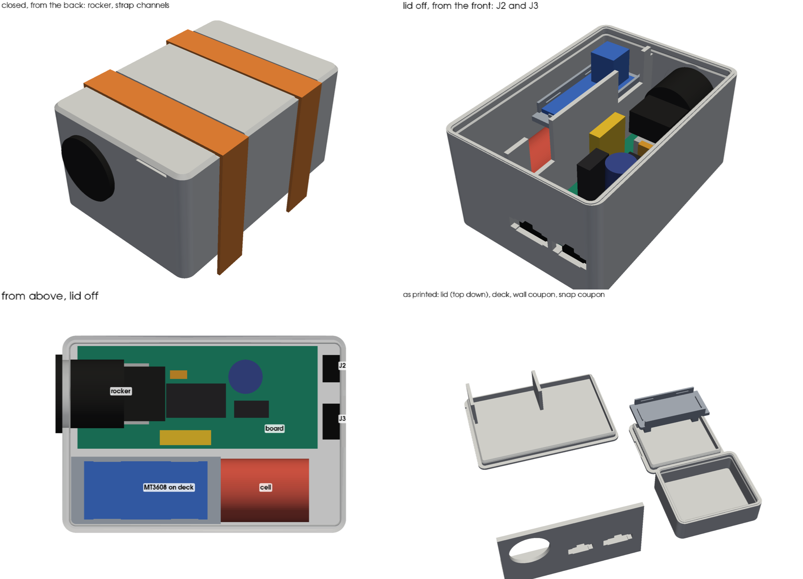

# Pod housing

Sealed TPU box for the controller pod. It holds the pod PCB, the 18650 on its PH2.0
pigtail, the MT3608 module (U1), the KCD1 rocker (SW1) and both arm plugs, J2 (SM-3)
and J3 (SM-4). There are two halves, a deep bottom and a snap-on lid. The gaskets are
TPU, printed as part of the halves. The case is there to protect the board, so the
XIAO's USB-C has no opening. Flash it with the lid off.

## v3 — current

**Outside:** 82.7 × 57.6 × 42.3, with 1.2 chamfers on the bottom and lid edges. The
outside is smooth apart from these:

- the rocker's bezel on the back end
- J2 and J3 side by side in the front end
- two strap channels across the lid
- a fingernail notch under the lid edge at the back end, on the cell side

### Ends and wearing

- **Back end (-X):** the end behind the XIAO. The rocker points out of it
- **Front end (+X):** past the board's J2/J3 pads. J2 and J3 sit side by side here,
  in line with the board
- **Straps:** two 12 mm Velcro straps go over the top, in 13.5 × 1.0 channels across
  the lid, 40 apart. They also help hold the lid down

### Layout

- **Board:** on four standoffs, 3.5 above the floor, with an M2×6 self-tapping screw in
  each corner hole. Its back edge is 2.0 off the back wall, so the XIAO's USB-C socket
  clears the wall by 0.5
- **Rocker:** comes through the back wall at the XIAO's centre line. Its 20 body lies
  over the XIAO, 1.0 clear of the socket
  - Its 30 depth (body, terminals and spade lugs) ends at X 25.6, short of C2 at 27
  - The lug wires come off over U2, with room to turn, and run to SW1
  - It sits in the bottom, so the lid comes off untethered
- **Cell:** beside the board in its own compartment
  - It rides on three saddles, 1.0 off the floor
  - The lead comes out of the front end, where there's 9 to turn it back over the
    cell. The mated PH2.0 pair lies on the cell past the deck
  - The J1 lead crosses the divider through a notch near the J1 pads
- **MT3608:** on a TPU deck that lies on top of the cell, components up, held by four
  snap lips
  - Two pads under the deck press the cell 0.2, right over two saddles
  - Two ribs on the lid press the deck down 0.2
  - Nothing narrows the cell bay, so the cell lifts straight out once the deck is off
  - U1's wires cross the divider through a notch near the U1 pads
- **J2, J3:** JST's own panel cutout for the SMP plug housing, from the 1.5–2.0
  column. The front wall is 1.8, so no spot faces are needed. You push each housing
  out from inside until the barbs click, and its flange pulls tight on the inside face

### Why it's 42.3 tall

The rocker's body is 20 across and has to clear the XIAO's socket (12.0 above the
floor). The lid's skirt also has to stay above it. So the box is 37.5 inside: 9.5
taller than the board alone needs (28.0). Lifting the module onto the cell makes use of the
height and keeps the length to 82.7.

### Seals and fixings

- **Lid:** snaps on, with no screws. It opens without a tool: put a fingernail in the
  notch and peel the lid up
  - **Skirt:** 3.7 deep inside the walls, 0.25 oversize over its top 1.8. This is the
    main seal
  - **Snap:** a 0.45 bead on the skirt drops into a groove in the walls. The bead and
    groove faces are 45°, the steepest either half prints without support
  - **Wall-top bead:** 1.0 × 0.3. The snap catches with the lid 0.1 up, so the bead
    stays squashed by 0.2
- **Rocker:** a Ø19.8 hole, 0.2 under the 20 mm cutout
  - The TPU grips the body all round
  - The bezel sits on the flat back wall
  - The wall is thinned to 2.0 round the hole, for the snap clips
- **J2, J3:** the housing flange on the inside face, pulled tight by the barbs

### Sources

- **Board:** outline, holes and part positions from [pod_pcb.py](../../docs/pcb/pod_pcb.py).
  Part heights from the [PCB README](../../docs/pcb/README.md): C1 17–22, Q1 ~20,
  F1 ~18
- **SMP cutout:** JST SM catalogue (`jst-mfg.com/product/pdf/eng/eSM.pdf`), panel
  layout, the 1.5–2.0 panel column
  - SM-3: A 8.2, B 12.5. SM-4: A 10.7, B 15.0
  - Heights 4.15 (B band) and 5.15 (A band), key 4.0 × 1.6
- **Pod leads:** both end in SMP plug housings, the half with the springy side barbs,
  read from the bench photo of 2026-10-29
- **From darknetdoll, 2026-10-29:**
  - Cell: Ø18.5 × 69, lead on the end
  - Rocker: about 30 deep, out of the back over the board, behind the XIAO
  - Velcro: 12 wide, over the top
  - J2/J3: side by side on the front end
  - USB-C: no opening

### Not measured — check before printing the bottom

Every value is a constant at the top of `export_v3.py`. Change it there and re-run.

| What | Used | Drives |
|---|---|---|
| XIAO's USB-C socket top above the PCB | 6.9 (12.0 above the floor) | rocker height, and so the box height |
| MT3608 module L × W × H | 36 × 17 × 14 (listing size) | deck pocket. Top at 35.8, 1.7 under the lid |
| MT3608 trimpot position | not at a long edge | the lid's skirt comes 1.2 in from the walls above 33.8 |
| 0.1 µF disc C3 height above the PCB | 9 | sits under the rocker's lugs, 4.4 clear |
| KCD1 body Ø and depth before the terminals | 20, 18 | rocker stand-in |
| KCD1 panel range for the snap clips | 2.0 used | back wall at the rocker |
| Tallest part above the PCB (C1 as fitted) | 22 | the board alone needs 28 inside; the box has 37.5 |

The export's clash check puts stand-ins for all of these in the box and finds no
overlap, apart from the deck pads' and lid ribs' 0.2 squeezes, which are deliberate.

### Print

- **Material:** TPU 95A from the external spool, for every part. Not "TPU for AMS":
  that's 68D and too stiff to seal (see
  [wrist-splint-mount.md](../wrist-splint-mount/wrist-splint-mount.md))
- **Walls:** set wall loops to 6 or more so the walls print solid. Use 12 top and
  bottom layers at 0.2
- **Bridges:** print the bridges slowly. The tops of the SMP cutouts (up to 15.0
  wide) and of the rocker hole (~7) bridge. Trim any sag

| File | Orientation | Supports |
|---|---|---|
| `versions/pod-housing-v3-snap-coupon.stl` | As exported: small box upright, its lid top down | None. **Print first** |
| `versions/pod-housing-v3-wall-coupon.stl` | On its foot | None. **Print first** |
| `versions/pod-housing-v3-bottom.stl` | Floor on the bed | None |
| `versions/pod-housing-v3-lid.stl` | Top face down (as exported) | None |
| `versions/pod-housing-v3-deck.stl` | Flat, as exported | None |

What each coupon tests:

- **Snap coupon:** a 42 × 34 box with the real wall top, groove, lid skirt and a strap
  channel. Use it to check:
  - how hard the lid is to snap on and to peel off
  - whether it seals: fill the box with water and turn it over
- **Wall coupon:** the back wall round the rocker hole, and a 1.8 stretch with both
  SMP cutouts, at their real heights and printed the same way as the bottom

### Assembly

1. Fit the board onto the standoffs, 4 × M2×6 self-tapping
2. Snap the rocker in from outside the back wall. Its body lies over the XIAO. Run
   the lug wires to SW1
3. Push J2 and J3 out through the front wall from inside, key up, until they click.
   J2 is the SM-3, on the board's outer edge. Its lead is long: coil the spare, or
   shorten it
4. Lay the cell on the saddles, lead toward the front. Mate PH2.0 and lay the pair
   on the cell's front half
5. Set the deck on the cell's back half, rails up. Feed U1's wires over the divider
   notch, then press the MT3608 into its pocket, components up
6. Press the lid on, starting at one end, until the snap clicks all round
7. Straps over the top, in the channels

### Decided

- **Seal, no drain** (darknetdoll, 2026-10-29). This overrides BUILD step 11's "drain
  it, don't seal it": no drain hole and no breather
  - Opening the pod to dry it after every event (BUILD step 11) matters more now
- **MT3608 in the cell compartment is fine** (darknetdoll, 2026-10-29). This overrides
  BUILD step 11's rule of nothing soldered in with the cell. The TPU deck keeps the
  module off the cell

### Open

- **Snap hold:** a 45° TPU snap with no screws, also held by the straps over the top.
  If the snap coupon lets go too easily, the snap can be made deeper
- **Arm fit:** the bottom is flat and 57.6 wide, so it will rock on a round upper arm

## v2 — archived, never printed

Snap lid and module deck as v3. Differences from v3:

- The rocker hung from the lid
- The MT3608 deck sat over the XIAO
- J2 and J3 were on either side of the rocker in the front end
- The USB-C port came through a 5.4 back wall, with a plug
- Four Velcro loops at the base
- 104.0 × 57.3 × 36.4
- **Files:** `versions/archive/pod-housing-v2-*.stl` (`export_v2.py`)

## v1 — archived, never printed

Same board, cell compartment and plug cutouts. Differences from v3:

- The rocker went through the cell-side wall
- The MT3608 had its own bay past the board
- The lid was screwed down with 4 × M3 into corner ears outside the walls
- The USB-C port had a collar standing 3 proud of the end wall
- 116.0 × 57.6 × 32.8, ears to 126 × 68
- **Files:** `versions/archive/pod-housing-v1-*.stl` (`export_v1.py`)

## Print log

| Date | Version | Result |
|---|---|---|
